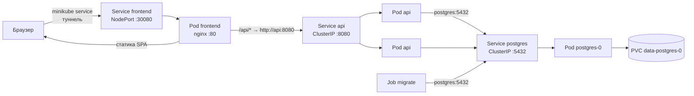

# Отчёт: развёртывание Repair Desk в Kubernetes (minikube)

Окружение: minikube v1.38.1 (драйвер `docker`, одна нода), Kubernetes v1.35.1, Windows 10.

## Содержимое архива

| Путь | Назначение |
|---|---|
| `k8s/00-namespace.yaml` | Namespace `repair-desk` |
| `k8s/10-postgres.yaml` | PostgreSQL: StatefulSet + Service |
| `k8s/20-migrate-job.yaml` | Миграции БД: Job |
| `k8s/30-api.yaml` | Backend: ConfigMap + Deployment + Service |
| `k8s/40-frontend.yaml` | Frontend: Deployment + Service (NodePort) |
| `build/Dockerfile` | Образ `repair-desk-api` (Go, multi-stage) |
| `build/frontend/Dockerfile` | Образ `repair-desk-frontend` (сборка React → nginx) |
| `build/frontend/nginx/default.conf.template` | Конфигурация nginx: статика + прокси `/api/` |
| `build/migrations/Dockerfile`, `*.sql` | Образ `repair-desk-migrate` (golang-migrate + SQL-файлы) |
| `Makefile` | Команды сборки и развёртывания (цели `k8s-*`) |
| `.env.example` | Формат файла, из которого создаётся Secret |
| `screencast.*` | Запись экрана с демонстрацией |

## Сборка и развёртывание

```sh
minikube start --driver=docker

# Сборка образов в Docker-демоне minikube (make k8s-build)
eval $(minikube docker-env)
docker build -t repair-desk-api:0.1.0 .
docker build -t repair-desk-frontend:0.1.0 frontend
docker build -t repair-desk-migrate:0.1.0 migrations

# Secret из .env (make k8s-secret)
kubectl apply -f k8s/00-namespace.yaml
kubectl -n repair-desk create secret generic postgres-credentials \
  --from-literal=POSTGRES_DB=... --from-literal=POSTGRES_USER=... --from-literal=POSTGRES_PASSWORD=...

# Развёртывание (make k8s-deploy)
kubectl apply -f k8s/

# Доступ из браузера (make k8s-url)
minikube service frontend -n repair-desk --url
```

Образы собираются сразу в Docker внутри minikube, поэтому `minikube image load` не требуется: кластер видит их локально. В манифестах `imagePullPolicy: IfNotPresent`, теги фиксированные (`0.1.0`), а не `latest`.

Секрет не хранится в репозитории: он создаётся командой `kubectl create secret` из локального `.env`.

## 1. Использованные абстракции Kubernetes

| Абстракция | Объекты | Зачем |
|---|---|---|
| **Namespace** | `repair-desk` | Изолирует ресурсы приложения; всё удаляется одной командой `kubectl delete namespace repair-desk` |
| **Deployment** → ReplicaSet → Pod | `api` (2 реплики), `frontend` (1 реплика) | Stateless-сервисы: Deployment поддерживает нужное число подов, пересоздаёт упавшие, выполняет rolling update (`maxSurge: 1`, `maxUnavailable: 0`: новый под поднимается до остановки старого). Масштабируются `kubectl scale` |
| **StatefulSet** | `postgres` (1 реплика) | База данных хранит состояние, поэтому нужен StatefulSet, а не Deployment: под получает постоянное имя `postgres-0` и свой постоянный том, который сохраняется при пересоздании пода |
| **PersistentVolumeClaim / PersistentVolume** | `data-postgres-0` (1 Gi, RWO) | Создаётся из `volumeClaimTemplates` StatefulSet. PV выделяется динамически через StorageClass `standard` (дополнение minikube `storage-provisioner`). Данные БД переживают удаление пода |
| **Job** | `migrate` | Разовая задача (фактор XII): применяет миграции и завершается. `backoffLimit: 10`, `activeDeadlineSeconds: 600`, `ttlSecondsAfterFinished: 600` (завершённый Job удаляется автоматически) |
| **Service: ClusterIP** | `postgres:5432`, `api:8080` | Постоянный внутренний IP и DNS-имя для группы подов (по label selector), балансировка между репликами. Доступны только внутри кластера |
| **Service: NodePort** | `frontend` (80 → nodePort 30080) | Открывает frontend снаружи кластера; используется `minikube service` |
| **ConfigMap** | `api-config` | Несекретная конфигурация API: `HTTP_PORT`, `LOG_LEVEL`, `POSTGRES_HOST`, `POSTGRES_PORT`, `POSTGRES_SSLMODE` |
| **Secret** | `postgres-credentials` | `POSTGRES_DB`, `POSTGRES_USER`, `POSTGRES_PASSWORD`. Подключается через `envFrom` в postgres, api и migrate |
| **Init containers** | `wait-for-postgres` в `api` и `migrate` | Ждёт `pg_isready -h postgres`, чтобы основной контейнер не падал, пока БД инициализируется |
| **Probes** | readiness / liveness | `postgres`: `pg_isready`. `api`: readiness → `GET /readyz` (проверяет БД; не готовый под исключается из Service), liveness → `GET /healthz` (перезапуск зависшего процесса). `frontend`: `GET /` |
| **Resources** | requests / limits у всех контейнеров | Планировщик резервирует ресурсы; limits ограничивают потребление |
| **securityContext** | у `api` | `runAsNonRoot`, `allowPrivilegeEscalation: false`, `readOnlyRootFilesystem: true` |
| **Labels / selectors** | `app: postgres`, `app: api`, `app: frontend` | Связывают Deployment/StatefulSet с подами и Service с подами |

## 2. Взаимодействие сервисов



Путь запроса:

1. **Браузер → frontend.** `minikube service frontend -n repair-desk` пробрасывает туннель на NodePort `30080` сервиса `frontend`. Service направляет запрос в под nginx.
2. **frontend → api.** nginx отдаёт собранное React-приложение. Запросы браузера к `/api/*` nginx проксирует на `http://api:8080` (адрес задан переменной окружения `API_UPSTREAM`). Имя `api` резолвится DNS кластера (CoreDNS) в ClusterIP сервиса `api` (`api.repair-desk.svc.cluster.local`). Браузер работает с одним origin, CORS не нужен.
3. **api: балансировка.** Service `api` распределяет запросы между всеми готовыми подами (прошедшими readiness probe `/readyz`). При `kubectl scale` новые поды автоматически попадают в endpoints сервиса. API не хранит состояние, поэтому любой под может обработать любой запрос.
4. **api → postgres.** Поды API подключаются к `postgres:5432` (`POSTGRES_HOST` из ConfigMap, учётные данные из Secret). Service `postgres` направляет соединения в под `postgres-0`, данные лежат на PVC.
5. **migrate → postgres.** Job `migrate` подключается к той же БД через Service `postgres`, применяет SQL-миграции и завершается.

Порядок запуска при `kubectl apply -f k8s/`: все объекты создаются сразу, порядок обеспечивают init containers и пробы:

```
postgres-0 стартует → readiness (pg_isready) OK
  → init container wait-for-postgres в migrate и api завершается
  → migrate применяет миграции → Completed
  → api стартует → readiness /readyz OK → попадает в Service api
  → frontend (nginx) проксирует /api на Service api
```

Внутри кластера наружу открыт только `frontend`; `api` и `postgres` доступны только через ClusterIP.

## 3. Масштабирование

```sh
kubectl -n repair-desk scale deployment api --replicas=4
kubectl -n repair-desk scale deployment frontend --replicas=2
```

Результат (проверено):

```
NAME                       READY   UP-TO-DATE   AVAILABLE
deployment.apps/api        4/4     4            4
deployment.apps/frontend   2/2     2            2
```

Все 4 пода `api` появляются в endpoints сервиса `api` и получают трафик.

`postgres` не масштабируется через `kubectl scale`: каждая реплика StatefulSet получила бы собственный пустой том, то есть независимую базу без репликации. Для отказоустойчивой БД нужна настройка репликации PostgreSQL (например, оператор), это вне рамок задания.

## 4. Проверенное поведение

- `kubectl apply -f k8s/` с нуля: все поды `Running`, Job `migrate` — `Completed`, без рестартов, около 30 секунд.
- Удаление пода `api` — Deployment создаёт новый под.
- Удаление пода `postgres-0` — StatefulSet пересоздаёт под с тем же томом, созданные заявки сохраняются.
- `kubectl scale` — новые реплики становятся готовыми и попадают в Service.
- UI доступен через `minikube service frontend -n repair-desk`.
