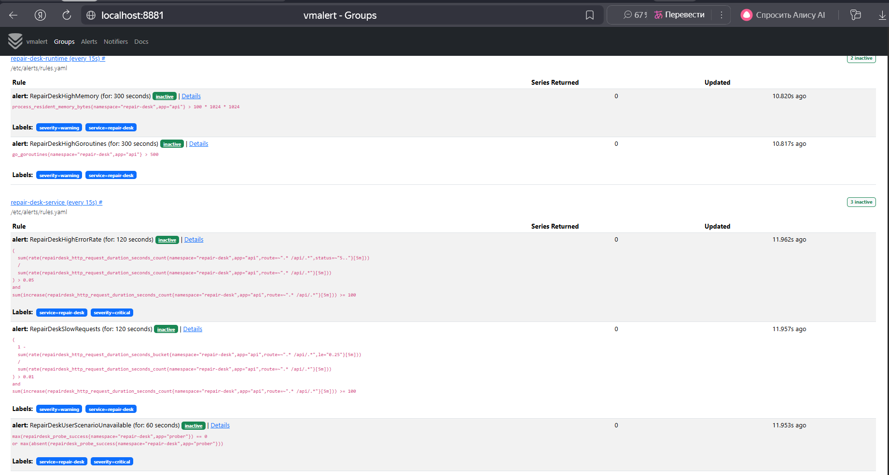
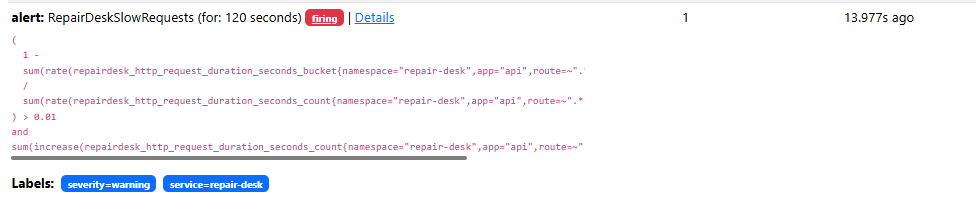
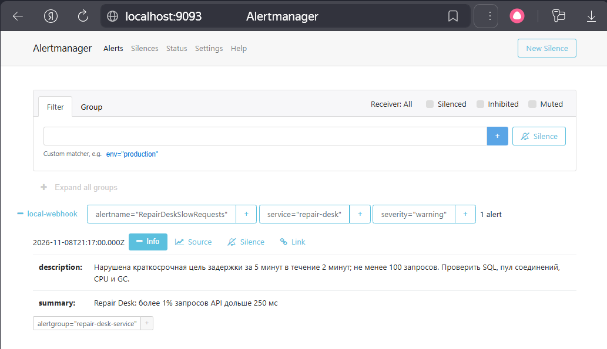
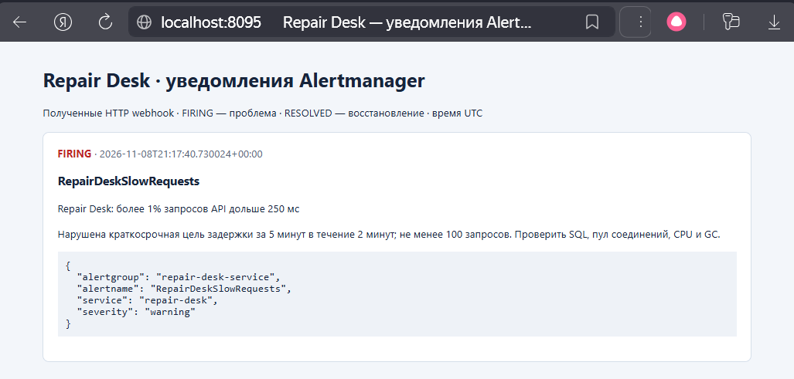
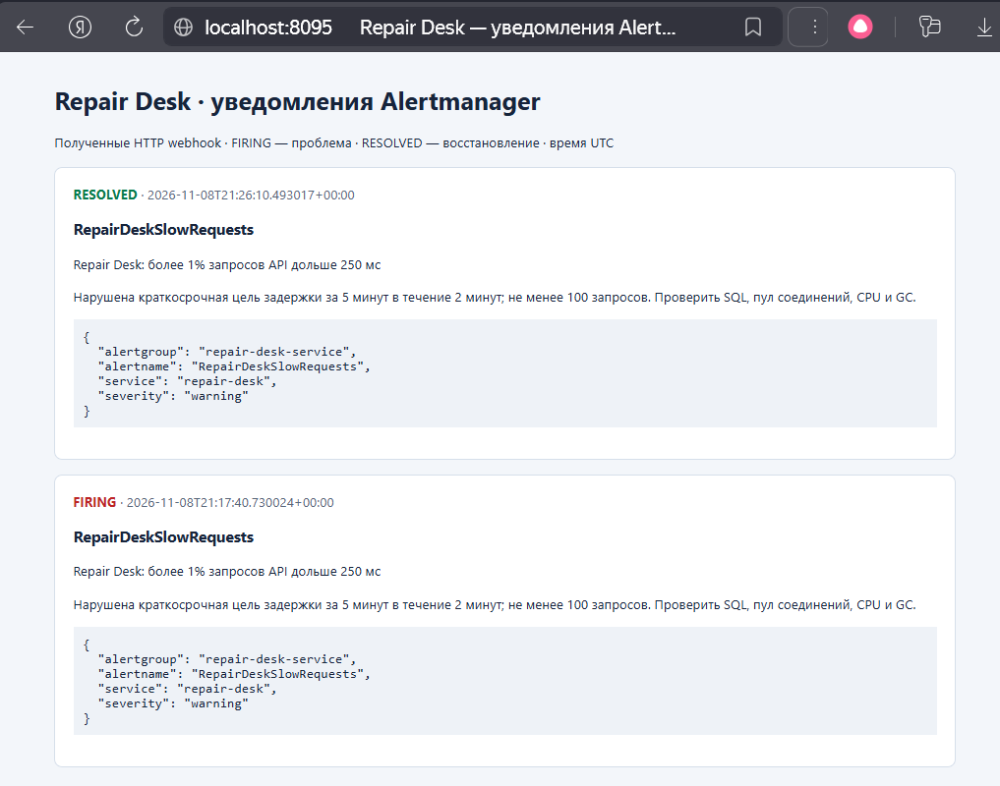

# Алерты Repair Desk

## Условия и обоснование

| Алерт | Условие | Удержание `for` | Уровень и причина |
|---|---|---|---|
| `RepairDeskHighErrorRate` | Доля 5xx за 5 минут > 5%, минимум 100 запросов | 2 минуты | critical: заметная деградация, расход бюджета ошибок в 10 раз быстрее цели SLO доступности 99,5% |
| `RepairDeskSlowRequests` | Доля запросов дольше 250 мс за 5 минут > 1%, минимум 100 запросов | 2 минуты | warning: краткосрочное отклонение от SLO задержки 99% ≤ 250 мс |
| `RepairDeskUserScenarioUnavailable` | Все проберы возвращают 0 либо метрика пробера отсутствует | 1 минута | critical: пользователь не может открыть страницу заявок либо потерян контроль доступности |
| `RepairDeskHighMemory` | RSS процесса API > 100 MiB | 5 минут | warning: запас перед лимитом контейнера 128 MiB из `k8s/30-api.yaml` |
| `RepairDeskHighGoroutines` | В одной реплике API > 500 горутин | 5 минут | warning: возможны зависшие запросы, утечка горутин или ожидание пула БД |

Первые три — метрики сервиса, последние два — рантайма/процесса Go.
Порог горутин — начальная эксплуатационная гипотеза, его следует уточнить по
обычной нагрузке.

Все запросы ограничены `namespace="repair-desk"`, `app="api"` или `app="prober"`.
API-запросы отбираются по шаблону `route=~".* /api/.*"`, поэтому `/healthz`,
`/readyz` и unmatched-маршруты не искажают SLI. Ответы 4xx не считаются серверными
ошибками. `rate`/`increase` вычисляются **до** суммирования реплик: сброс счётчика
при перезапуске не создаёт ложный всплеск, доли взвешены по числу запросов.
Задержка определяется по реальному бакету histogram `le="0.25"`, без приближённого p99.

Окно 5 минут сглаживает шум, `for` требует устойчивого нарушения. При трафике ниже
100 запросов за окно HTTP-алерты намеренно молчат; низкую нагрузку и полный отказ
покрывает пробер. Эти короткие окна — оперативные сигналы, они не доказывают
нарушение месячного SLA и не заменяют графики SLO за 30 дней из `report5`.
При исчезновении таргета `absent` сработает после того, как TSDB перестанет считать
старый sample актуальным; `for: 1m` добавляется к этой задержке. Доступность самой
системы мониторинга должна контролироваться извне отдельным watchdog.

## Конфигурация

| Файл | Назначение |
|---|---|
| [`rules.yaml`](../k8s/monitoring/alerts/rules.yaml) | Полные PromQL-выражения, пороги, `for`, severity, объяснения и действия оператора |
| [`alertmanager.yaml`](../k8s/monitoring/alerts/alertmanager.yaml) | Маршрут, группировка, webhook и inhibition |
| [`workloads.yaml`](../k8s/monitoring/alerts/workloads.yaml) | metrics-vmalert, Alertmanager и inbox с внутренними Service, probes и ресурсами |
| [`kustomization.yaml`](../k8s/monitoring/alerts/kustomization.yaml) | ConfigMap из файлов; изменение конфигурации меняет hash и перезапускает соответствующий workload |
| [`inbox.py`](../k8s/monitoring/alerts/inbox.py) | Приём настоящих Alertmanager webhook и просмотр истории |
| [`compose.yaml`](../monitoring/compose.yaml) | Локальный стек без Kubernetes; использует те же rules и Alertmanager config |
| [`rules.test.yaml`](../monitoring/rules.test.yaml) | Сценарии проверки правил через promtool |
| [`load.py`](../monitoring/load.py) | Ограниченная по времени нагрузка только GET-запросами |

Alertmanager группирует по `service`, `alertname`, `severity`: несколько реплик не
порождают отдельные сообщения для одной причины. `group_wait=10s`,
`group_interval=30s`, `repeat_interval=4h`. `send_resolved: true` отправляет
восстановление. При `RepairDeskUserScenarioUnavailable` HTTP-симптомы
`HighErrorRate`/`SlowRequests` подавляются в уведомлениях (но видны в vmalert);
runtime-сигналы остаются доступны для диагностики.

Webhook `http://alert-inbox:8080/webhook` — **локальный канал демонстрации**.
Inbox сохраняет исходные payload и время получения в `notifications.jsonl`,
показывает FIRING/RESOLVED в браузере и отдаёт JSON через `/events`.
Alertmanager и inbox имеют постоянные тома; в Kubernetes — PVC по 256 MiB.
Демонстрационный inbox не имеет авторизации и ротации истории: его Service
внутренний, а Compose публикует UI только на loopback. Для production нужен
постоянный канал дежурного и ограничения хранения/доступа. Один Alertmanager здесь
не обеспечивает HA.

## 5. Развёртывание

Мониторинг и алерты разворачиваются из корня репозитория:

```sh
make monitoring-deploy
make alerts-test
make metric-alerts-deploy
```

Готовность компонентов проверяется командами:

```sh
kubectl -n monitoring rollout status deployment/metrics-vmalert
kubectl -n monitoring rollout status statefulset/alertmanager
kubectl -n monitoring rollout status statefulset/alert-inbox
```

Для доступа к интерфейсам в отдельных терминалах запускаются:

```sh
kubectl -n repair-desk port-forward svc/frontend 3000:80
kubectl -n monitoring port-forward svc/metrics-vmalert 8881:8880
kubectl -n monitoring port-forward svc/alertmanager 9093:9093
kubectl -n monitoring port-forward svc/alert-inbox 8095:8080
```

| Интерфейс | Адрес |
|---|---|
| Приложение | http://localhost:3000 |
| Правила vmalert | http://localhost:8881/vmalert/groups |
| Alertmanager | http://localhost:9093 |
| Полученные уведомления | http://localhost:8095 |


## 6. Проверка срабатывания

### 6.1. Созданные правила

В интерфейсе vmalert открыта страница групп и нажата кнопка `Expand All`.
На странице представлены все пять правил с условиями и временем удержания.




### 6.2. Внесение задержки

Для демонстрации используется существующий механизм fault injection.
В тестовом API включается задержка 400 мс:

```sh
kubectl -n repair-desk set env deployment/api \
  FAULT_ERROR_RATE=0 FAULT_DELAY_MS=400

kubectl -n repair-desk rollout status deployment/api
```

После обновления реплик запускается нагрузка через frontend:

```sh
python monitoring/load.py --url http://localhost:3000 --seconds 300
```

Скрипт выполняет GET-запросы к списку заявок, не изменяя данные приложения.

Доля запросов дольше 250 мс превышает порог.
После накопления необходимого числа запросов и удержания условия в течение
двух минут `RepairDeskSlowRequests` переходит из `pending` в `firing`.



### 6.3. Получение алерта в Alertmanager

Alertmanager принимает алерт от vmalert и создаёт группу
`RepairDeskSlowRequests` с уровнем `warning` и получателем `local-webhook`.



### 6.4. Доставка уведомления

После обработки группы Alertmanager отправляет HTTP POST в webhook-приёмник.
В интерфейсе приёмника отображается уведомление `FIRING` с названием алерта,
описанием условия и временем получения.



### 6.5. Восстановление

После демонстрации fault injection отключается:

```sh
kubectl -n repair-desk set env deployment/api \
  FAULT_ERROR_RATE- FAULT_DELAY_MS-

kubectl -n repair-desk rollout status deployment/api
```

Затем запускается нормальная нагрузка:

```sh
python monitoring/load.py --url http://localhost:3000 --seconds 360
```

Когда плохие значения выходят из пятиминутного окна и условие перестаёт
выполняться, Alertmanager отправляет уведомление `RESOLVED`.


