# Отчёт: стратегии развёртывания Repair Desk

## Подготовка приложения и стенда

Repair Desk запущен в minikube. Входящий трафик проходит через Envoy Gateway и
Gateway API (`Gateway` + `HTTPRoute`) в namespace `repair-desk-release`.

- У каждого Deployment приложения по две реплики. Состояние хранится в общей PostgreSQL с PVC, вне подов API.
- Liveness-проба `/healthz` проверяет работу процесса, readiness-проба `/readyz` — доступность БД.
- Образы `repair-desk-api:v1.0.0` и `repair-desk-api:v2.0.0` содержат версию, встроенную при сборке. Она возвращается в `/api/v1/version` и заголовке `X-App-Version`.
- Счётчик `repairdesk_release_http_requests_total` разделяет запросы по версии и аудитории. VictoriaMetrics собирает метрики, Grafana показывает RPS и доли версий.

Подготовка и запуск нагрузки (команды выполняются из корня основного репозитория):

```bash
make release-gateway
make release-build
make release-deploy                 # также создаёт Secret из .env
make grafana-deploy
```

В отдельных терминалах:

```bash
make release-gateway-ui             # Envoy: localhost:8888
make release-traffic                # GET /api/v1/version, 25% beta и 75% default
kubectl -n monitoring port-forward svc/grafana 3001:80
```

PostgreSQL с применёнными миграциями и VictoriaMetrics используются из существующего
стенда. Графики построены с окном `rate(...[1m])`, поэтому быстрые переключения
маршрута визуально сглажены. Фильтр Grafana: `Rolling` для Rolling и `Parallel`
для остальных стратегий.

## 1. Rolling

**Суть:** старые реплики постепенно заменяются новыми, обе версии временно обслуживают запросы.

**Реализация:** один Deployment `release-rolling` и неизменный Service. Настройки
`maxSurge: 1`, `maxUnavailable: 0`, `minReadySeconds: 60` задают последовательную
замену подов с сохранением доступных реплик. HTTPRoute направлен на этот Service.

```bash
make release-route STRATEGY=rolling
make release-rolling RELEASE_VERSION=v2.0.0
```

На графиках видны одновременный трафик v1/v2 и перенос нагрузки на поды новой версии.

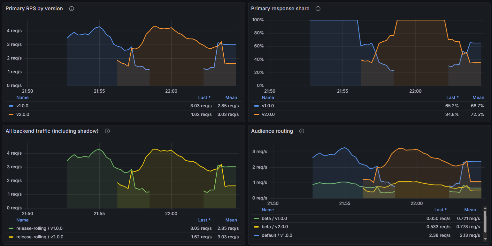

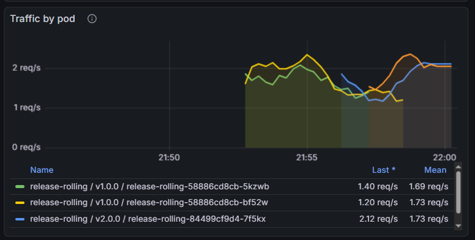

## 2. Blue/Green

**Суть:** обе версии подготовлены заранее; весь трафик переключается между ними изменением маршрута.

**Реализация:** отдельные Deployment и Service `release-v1` (blue) и `release-v2`
(green). В HTTPRoute меняется единственный backend, поды при переключении не пересоздаются.

```bash
make release-route STRATEGY=blue     # весь трафик на v1
make release-route STRATEGY=green    # переключение на v2
```

Доля v2 достигает 100%. На графике подов видно переключение между готовыми репликами.

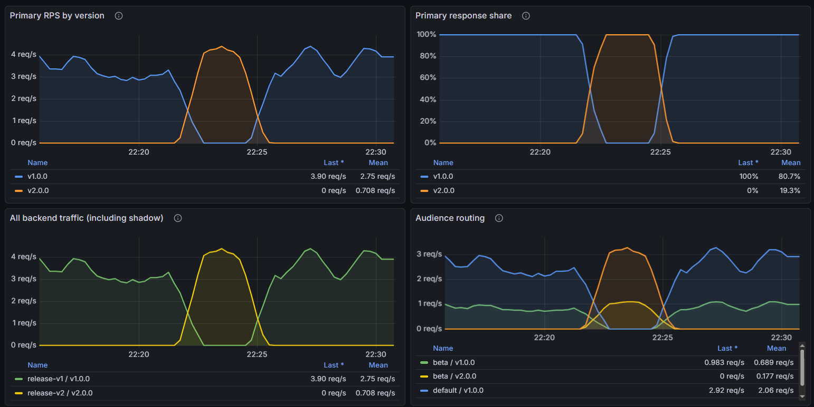

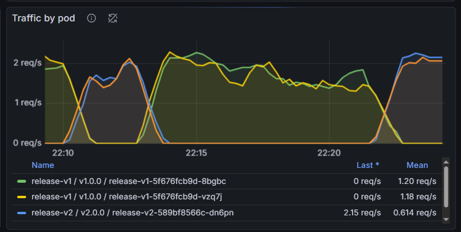

## 3. Canary

**Суть:** новая версия сначала получает небольшую часть запросов, затем её доля увеличивается.

**Реализация:** те же готовые v1/v2, но HTTPRoute содержит два backend с весами.
Последовательно применены соотношения v1/v2: **90/10 → 50/50 → 0/100**.

```bash
make release-route STRATEGY=canary-90-10
make release-route STRATEGY=canary-50-50
make release-route STRATEGY=canary-0-100
```

На графике доля v2 проходит плато около 10%, 50% и 100%; нагрузка распределяется
между подами соответствующих версий. Веса задают вероятности, поэтому измеренные доли могут немного отличаться.

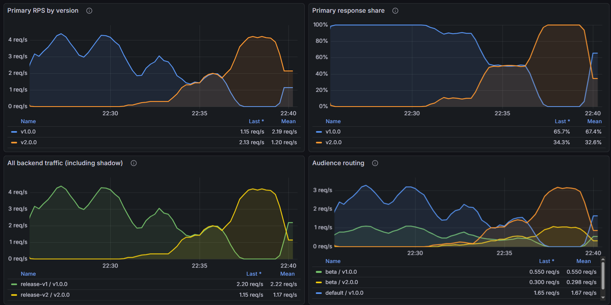

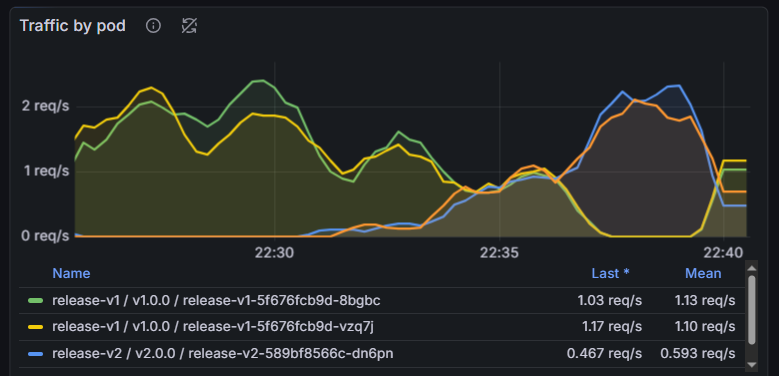

## 4. A/B по заголовку

**Суть:** новая версия доступна выбранной аудитории, а не случайной доле запросов.

**Реализация:** правило HTTPRoute отправляет запросы с `x-user-group: beta` на v2,
остальные — на v1. Генератор создаёт 25% beta-запросов, поэтому общая доля v2 около 25%.

```bash
make release-route STRATEGY=ab
```

Общий график показывает распределение около 75/25. При отдельном выборе аудитории
`default` получает 100% v1, а `beta` во время действия A/B — 100% v2.
В левой части снимков остаётся история предыдущей стратегии.

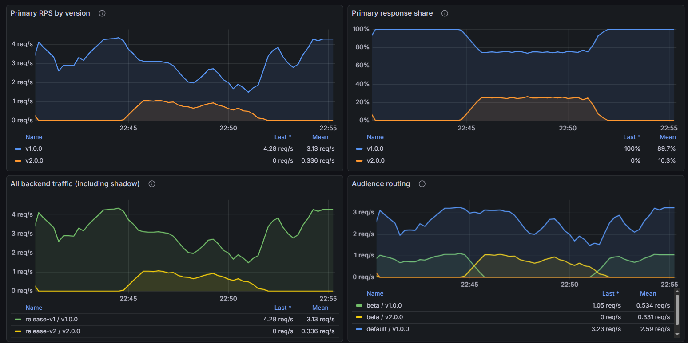

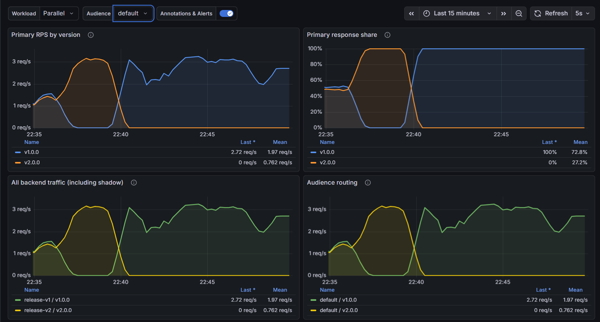

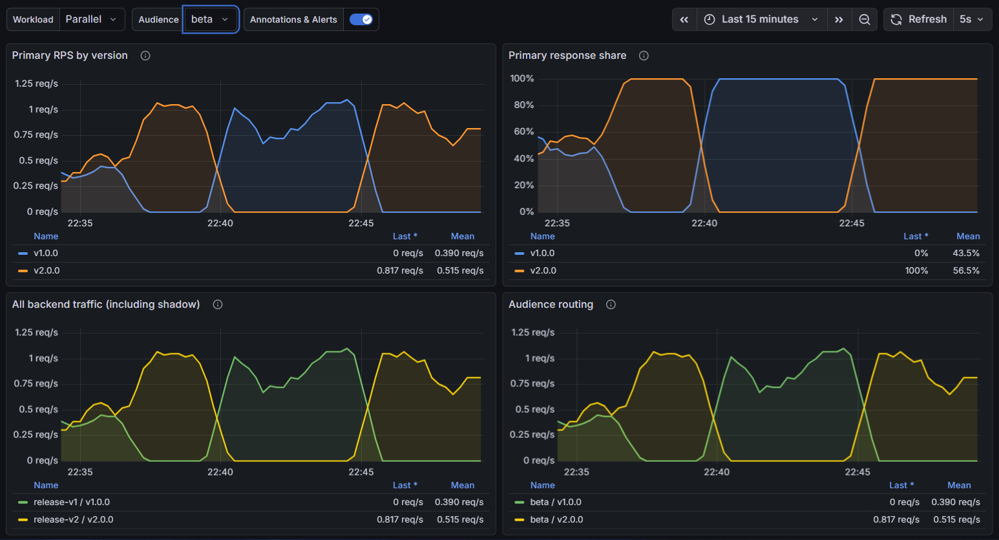

## 5. Shadow

**Суть:** клиент получает ответ стабильной версии, а копия запроса отправляется новой версии для проверки.

**Реализация:** фильтр `RequestMirror` копирует GET-запросы из v1 в отдельный
Service `release-shadow` с образом v2. На shadow-подах включён `SHADOW_READ_ONLY=true`:
middleware запрещает изменяющие запросы. Ответы зеркальной версии клиенту не возвращаются.

```bash
make release-route STRATEGY=shadow
```

На графике пользовательских ответов v1 получает 100%. При включённом зеркале
RPS `release-shadow` примерно равен RPS `release-v1`, отношение копий к основным
запросам — около 100%. Справа видно отключение зеркала: его RPS и отношение падают
к нулю, основной поток v1 сохраняется.

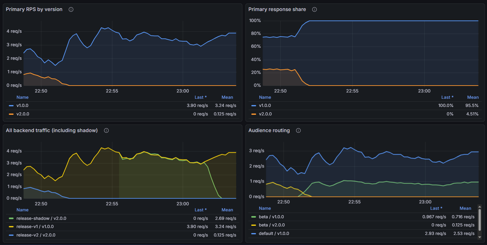

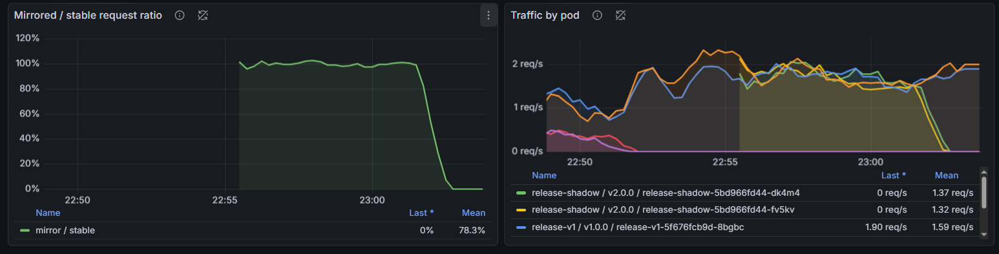

## Возврат к исходному состоянию

Для возврата клиентского трафика на v1 после любой стратегии и восстановления
Rolling Deployment до v1 используется одна команда:

```bash
make release-reset
```

Она применяет маршрут blue и манифест Rolling v1, сохраняя БД и метрики.

## Приложенные файлы

В `manifests/` находятся точные копии манифестов стратегий, release-подов, Gateway
и дашборда. В `scripts/` — скрипт управления переходами. Общая инфраструктура БД,
мониторинга и исходники приложения остаются в основном репозитории;
команды выше запускаются из его корня.

| Файл в отчёте | Назначение |
|---|---|
| `manifests/releases/base/namespace.yaml`, `gateway.yaml` | Namespace, GatewayClass и Gateway Envoy |
| `manifests/releases/base/release-v1.yaml`, `release-v2.yaml` | Deployment по две реплики и Service каждой версии; пробы, подключение к общей БД, аннотации сбора метрик |
| `manifests/releases/base/release-shadow.yaml` | Две реплики v2 для зеркальных запросов, режим read-only и отдельный Service |
| `manifests/releases/strategies/rolling-v1.0.0.yaml`, `rolling-v2.0.0.yaml` | Начальная и новая версии Rolling Deployment, настройки RollingUpdate |
| `manifests/releases/strategies/rolling.yaml` | Маршрут на Service `release-rolling` |
| `manifests/releases/strategies/blue.yaml`, `green.yaml` | Маршруты всего трафика на v1 или v2 |
| `manifests/releases/strategies/canary-90-10.yaml`, `canary-50-50.yaml`, `canary-0-100.yaml` | Веса backend на трёх этапах Canary |
| `manifests/releases/strategies/ab.yaml` | Выбор версии по заголовку аудитории |
| `manifests/releases/strategies/shadow.yaml` | Зеркалирование GET через RequestMirror |
| `manifests/monitoring/grafana/release-dashboard.json` | Панели RPS, долей версий, аудиторий, зеркалирования и трафика подов |
| `scripts/release.sh` | Подготовка release-подов, переключение маршрутов, генерация нагрузки, откат и сохранение логов; вызывается командами `make release-*` в основном репозитории |
| `screens/` | Скриншоты Grafana для пяти стратегий |
